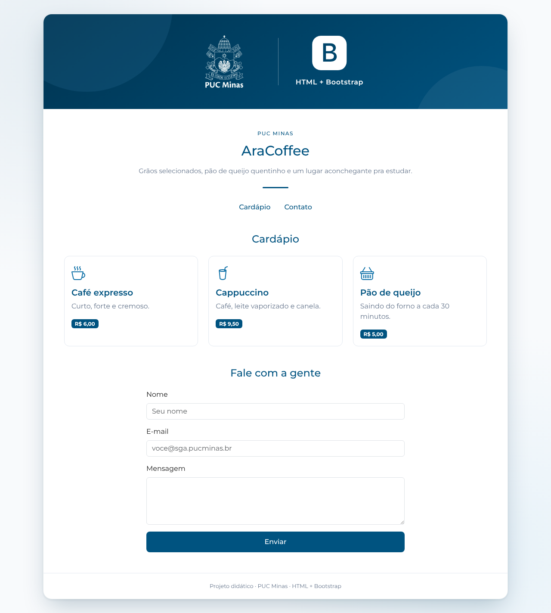
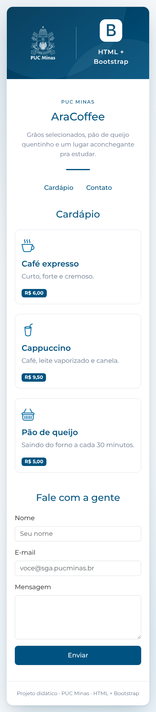
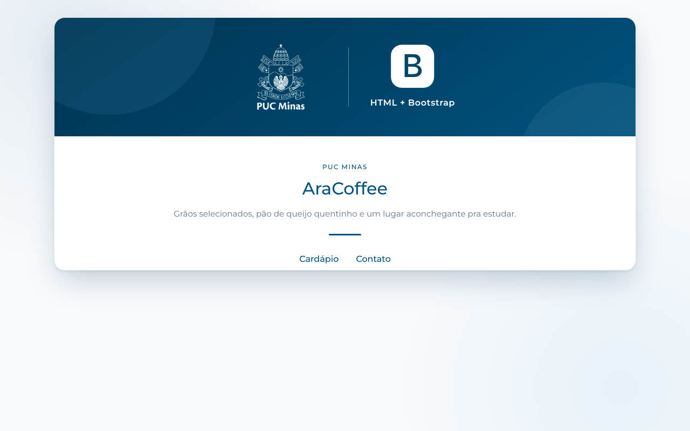

# Projeto AraCoffee (HTML + Bootstrap) ☕

## 📖 Descrição

Página de uma cafeteria fictícia feita só com **HTML** e **Bootstrap 5**, no mesmo estilo visual dos projetos PUC Minas (paleta azul, fonte Montserrat, card central com a faixa azul da logo). O projeto é montado em **6 passos**, e cada passo tem um arquivo pronto na pasta `passos/`.

Este projeto **não usa Node, npm nem API**: é só abrir o `index.html` no navegador.

O que os alunos aprendem:

- Importar o **Bootstrap**, o **Bootstrap Icons** e a fonte **Montserrat** por CDN
- Usar o **grid** (`container`, `row`, `col-*`) para fazer uma página responsiva
- Usar os componentes **nav**, **card**, **badge**, **form** e **button**
- Usar as **classes utilitárias** de espaçamento e texto (`mb-3`, `mt-4`, `text-center`...)
- Aplicar as **cores da PUC** com um `style.css` próprio, carregado depois do Bootstrap

## 🖼️ Capturas de Tela

| Página final | Celular |
| :---: | :---: |
|  |  |

| Passo 2: card e faixa azul | Passo 3: título e menu |
| :---: | :---: |
|  |  |

## 🚀 Como rodar

Abra o `index.html` no navegador (dois cliques no arquivo).

> Recomendado: no VS Code, instale a extensão **Live Server** e clique em **Go Live**. A página atualiza sozinha a cada vez que você salva o arquivo.

> O Bootstrap, os ícones e a fonte vêm da internet (CDN), então o computador precisa estar **online**.

## 🧭 Passo a passo

Cada passo acrescenta um pedaço ao `index.html`. O `css/style.css` já vem pronto e está dividido em blocos com o mesmo nome dos passos (`PASSO 1`, `PASSO 2`...), então dá para mostrar o CSS de cada passo junto com o HTML.

| Passo | Arquivo pronto | O que entra |
| --- | --- | --- |
| 1 | `passos/passo-1.html` | Estrutura HTML + Bootstrap + Montserrat + `style.css` |
| 2 | `passos/passo-2.html` | Card principal com a faixa azul (logo PUC + logo do Bootstrap) |
| 3 | `passos/passo-3.html` | Título "PUC MINAS" + menu (`nav-pills`) |
| 4 | `passos/passo-4.html` | Cardápio com grid e cards |
| 5 | `passos/passo-5.html` | Formulário de contato |
| 6 | `passos/passo-6.html` | Rodapé (igual ao `index.html`) |

### Passo 1 – Estrutura HTML e Bootstrap

```html
<!doctype html>
<html lang="pt-BR">
<head>
  <meta charset="utf-8">
  <meta name="viewport" content="width=device-width, initial-scale=1">
  <link rel="icon" type="image/png" href="assets/images/pucminas-logo.png">
  <title>AraCoffee - HTML + Bootstrap</title>

  <!-- Bootstrap (CSS) -->
  <link href="https://cdn.jsdelivr.net/npm/bootstrap@5.3.3/dist/css/bootstrap.min.css" rel="stylesheet">

  <!-- Bootstrap Icons -->
  <link href="https://cdn.jsdelivr.net/npm/bootstrap-icons@1.11.3/font/bootstrap-icons.min.css" rel="stylesheet">

  <!-- Fonte Montserrat - Google Fonts -->
  <link rel="preconnect" href="https://fonts.googleapis.com">
  <link rel="preconnect" href="https://fonts.gstatic.com" crossorigin>
  <link href="https://fonts.googleapis.com/css2?family=Montserrat:wght@400;500;600;700&display=swap" rel="stylesheet">

  <!-- Nosso CSS (sempre DEPOIS do Bootstrap) -->
  <link href="css/style.css" rel="stylesheet">
</head>
<body>

  <!-- Bootstrap (JavaScript) -->
  <script src="https://cdn.jsdelivr.net/npm/bootstrap@5.3.3/dist/js/bootstrap.bundle.min.js"></script>
</body>
</html>
```

**Para explicar:**

- `meta viewport` faz a página se adaptar ao celular.
- O Bootstrap é uma biblioteca de **classes prontas**: a gente coloca nomes de classe nas tags em vez de escrever CSS do zero.
- O `style.css` vem **depois** do Bootstrap para que as nossas regras (cores da PUC) tenham prioridade.
- No `style.css`, as cores ficam em **variáveis** (`--brand: #005380;`) e são usadas com `var(--brand)`.

**Teste:** a página fica em branco, só com o fundo claro com degradê azul.

### Passo 2 – Card principal e faixa azul

```html
<div class="page-container">

  <header class="page-hero">
    

    <span class="page-hero-divider" aria-hidden="true"></span>

    <div class="page-hero-brand">
      <i class="bi bi-bootstrap-fill" aria-hidden="true"></i>
      <span>HTML + Bootstrap</span>
    </div>
  </header>

  <!-- os próximos passos entram aqui dentro -->

</div>
```

**Para explicar:**

- `page-container` é o card branco com borda arredondada e sombra.
- `page-hero` é a faixa com o **degradê** azul (`linear-gradient`). Os dois círculos decorativos são feitos com `::before` e `::after`, sem nenhuma imagem.
- `<i class="bi bi-bootstrap-fill">` é um ícone do **Bootstrap Icons**. Outros ícones: [icons.getbootstrap.com](https://icons.getbootstrap.com/).

### Passo 3 – Título e menu

```html
<section class="page-intro">
  <span class="page-label">PUC MINAS</span>
  <h1>AraCoffee</h1>
  <p class="page-description">
    Grãos selecionados, pão de queijo quentinho e um lugar aconchegante pra estudar.
  </p>
  <div class="page-divider"></div>

  <ul class="nav nav-pills nav-puc justify-content-center mt-4">
    <li class="nav-item"><a class="nav-link" href="#cardapio">Cardápio</a></li>
    <li class="nav-item"><a class="nav-link" href="#contato">Contato</a></li>
  </ul>
</section>
```

**Para explicar:**

- `nav nav-pills` é um componente do Bootstrap; `nav-puc` é a nossa classe que muda a cor para o azul da PUC.
- `justify-content-center` centraliza os itens; `mt-4` é a margem de cima (m = margin, t = top, 4 = tamanho de 0 a 5).
- Os links `#cardapio` e `#contato` levam até o elemento com aquele `id` (criados nos passos 4 e 5).

### Passo 4 – Cardápio com grid e cards

O **grid** do Bootstrap divide a linha em **12 colunas**. `col-md-4` = 4 de 12 colunas, ou seja, 3 cards por linha no computador. No celular, `col-12` faz cada card ocupar a linha inteira.

```html
<main class="page-content">

  <section id="cardapio" class="mb-5">
    <h2 class="section-title">Cardápio</h2>

    <div class="row g-4">
      <div class="col-12 col-md-4">
        <div class="card card-puc h-100">
          <div class="card-body">
            <i class="bi bi-cup-hot card-icon"></i>
            <h5 class="card-title mt-2">Café expresso</h5>
            <p class="card-text">Curto, forte e cremoso.</p>
            <span class="badge badge-puc">R$ 6,00</span>
          </div>
        </div>
      </div>

      <!-- repita o bloco "col-12 col-md-4" para Cappuccino e Pão de queijo -->
    </div>
  </section>

</main>
```

**Para explicar:**

- `row` = linha; `col-*` = colunas dentro da linha; `g-4` = espaço entre os cards.
- `card`, `card-body`, `card-title`, `card-text` e `badge` são do Bootstrap. `card-puc` e `badge-puc` são nossas (cores da PUC e o card "subindo" no hover).
- `h-100` deixa todos os cards com a mesma altura.

### Passo 5 – Formulário de contato

Dentro do `<main>`, depois do cardápio:

```html
<section id="contato" class="mx-auto" style="max-width: 600px;">
  <h2 class="section-title">Fale com a gente</h2>

  <form>
    <div class="mb-3">
      <label for="nome" class="form-label">Nome</label>
      <input type="text" class="form-control" id="nome" placeholder="Seu nome">
    </div>

    <div class="mb-3">
      <label for="email" class="form-label">E-mail</label>
      <input type="email" class="form-control" id="email" placeholder="voce@sga.pucminas.br">
    </div>

    <div class="mb-3">
      <label for="mensagem" class="form-label">Mensagem</label>
      <textarea class="form-control" id="mensagem" rows="4"></textarea>
    </div>

    <button type="submit" class="btn btn-puc w-100">Enviar</button>
  </form>
</section>
```

**Para explicar:**

- `form-control` estiliza os campos; `form-label` estiliza os rótulos; `mb-3` dá espaço entre eles.
- O `for` do `label` precisa ser igual ao `id` do campo: clicar no texto coloca o cursor no campo.
- `mx-auto` centraliza o formulário; `w-100` deixa o botão com 100% da largura.
- `btn` é do Bootstrap; `btn-puc` é o nosso botão azul (no lugar do `btn-primary`).

### Passo 6 – Rodapé

Depois do `</main>`, ainda dentro do `page-container`:

```html
<footer class="page-footer">
  Projeto didático · PUC Minas · HTML + Bootstrap
</footer>
```

**Teste final:** clique nos links do menu e veja a página no modo celular (**F12** → ícone de celular).

## 🎨 Classes usadas

| Classe | Origem | O que faz |
| --- | --- | --- |
| `row` / `col-12 col-md-4` | Bootstrap | Linha e colunas do grid (12 colunas) |
| `mt-*`, `mb-*`, `mx-auto`, `g-*` | Bootstrap | Margens e espaço entre colunas (0 a 5) |
| `text-center`, `justify-content-center` | Bootstrap | Alinhamento |
| `nav nav-pills` | Bootstrap | Menu |
| `card`, `card-body`, `badge` | Bootstrap | Cartão e etiqueta |
| `form-control`, `form-label`, `btn` | Bootstrap | Formulário e botão |
| `bi bi-*` | Bootstrap Icons | Ícones |
| `page-container`, `page-hero`, `page-intro` | `style.css` | Layout padrão PUC Minas |
| `nav-puc`, `card-puc`, `badge-puc`, `btn-puc` | `style.css` | Componentes com as cores da PUC |

## 📂 Estrutura do Projeto

```text
📁 AraCoffee_Bootstrap
│
├── 📁 assets/images
│   └── pucminas-logo.png
│       └── Logo da faixa azul e favicon
│
├── 📁 css
│   └── style.css
│       └── Variáveis de cor da PUC + estilos de cada passo
│
├── 📁 imgs
│   └── Capturas de tela usadas neste README
│
├── 📁 passos
│   ├── passo-1.html  └── Estrutura + Bootstrap
│   ├── passo-2.html  └── Card + faixa azul
│   ├── passo-3.html  └── Título + menu
│   ├── passo-4.html  └── Cardápio (grid + cards)
│   ├── passo-5.html  └── Formulário
│   └── passo-6.html  └── Rodapé (página completa)
│
├── 📄 index.html
│   └── Página final
│
└── 📄 README.md
```

## 🏋️ Desafios para os alunos

1. Adicionar um 4º produto ao cardápio e mudar para `col-md-3` (4 por linha). Por que 3? Porque 4 × 3 = 12.
2. Trocar os ícones dos cards por outros do [Bootstrap Icons](https://icons.getbootstrap.com/).
3. Criar uma seção **"Sobre nós"** com duas colunas (`col-md-6`): texto de um lado, imagem do outro.
4. Pesquisar um componente novo na [documentação do Bootstrap](https://getbootstrap.com/docs/5.3/) e adicioná-lo, como um **accordion** com perguntas frequentes.
5. Mudar a variável `--brand` no `style.css` e ver a página inteira trocar de cor.

## 📦 Dependências (CDN)

```html
<!-- Bootstrap 5.3.3 -->
https://cdn.jsdelivr.net/npm/bootstrap@5.3.3/dist/css/bootstrap.min.css
https://cdn.jsdelivr.net/npm/bootstrap@5.3.3/dist/js/bootstrap.bundle.min.js

<!-- Bootstrap Icons 1.11.3 -->
https://cdn.jsdelivr.net/npm/bootstrap-icons@1.11.3/font/bootstrap-icons.min.css

<!-- Montserrat -->
https://fonts.googleapis.com/css2?family=Montserrat:wght@400;500;600;700
```

- [Bootstrap](https://getbootstrap.com/): grid, componentes e classes utilitárias
- [Bootstrap Icons](https://icons.getbootstrap.com/): ícones
- [Google Fonts – Montserrat](https://fonts.google.com/specimen/Montserrat): fonte padrão dos projetos PUC Minas

## 📄 Licença
Este projeto está licenciado sob a MIT License.
