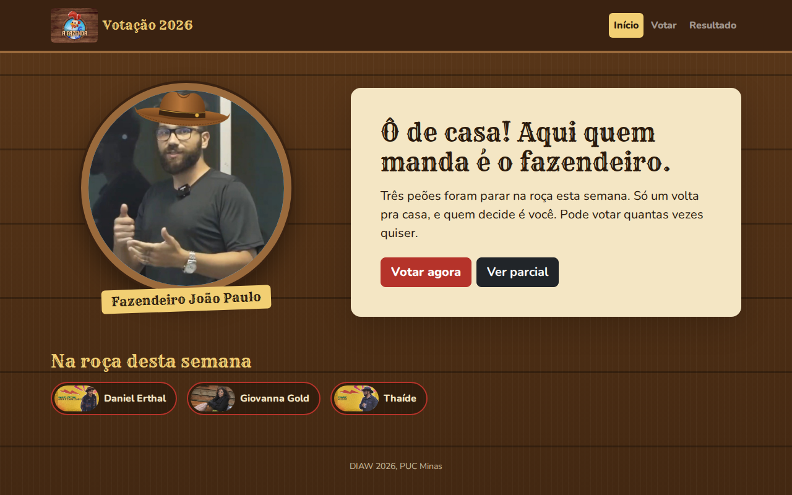
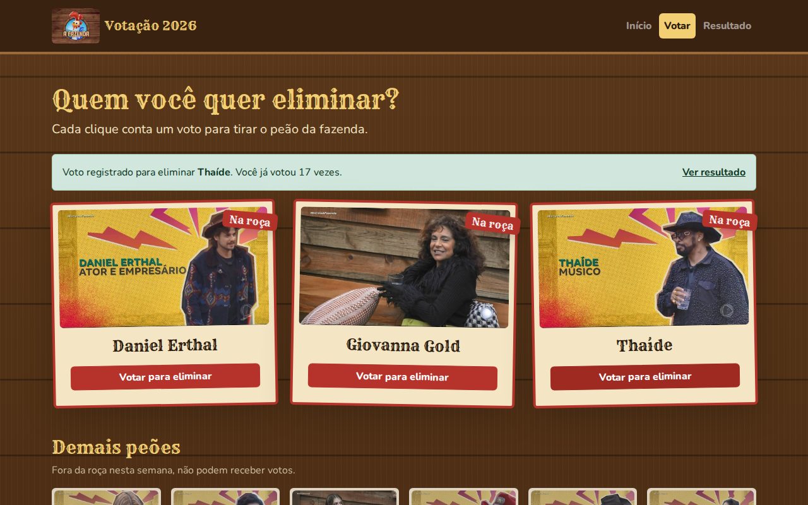
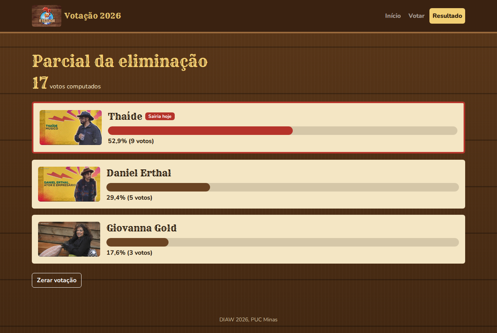
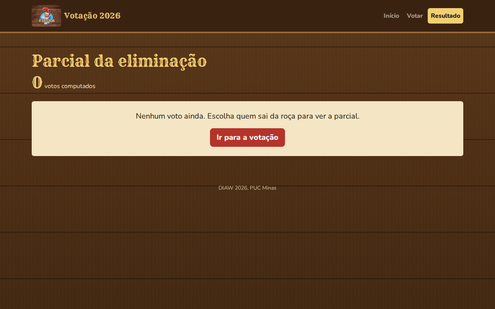

# 🐓 Projeto Votação A Fazenda 2026 (Bootstrap + JSON Server)

Aplicação para a votação de eliminação de **A Fazenda 2026**, feita com **HTML, CSS, JavaScript, Bootstrap 5** e **JSON Server**. O usuário vê quem está na roça, vota em quem deve deixar o programa e acompanha a parcial com o total de votos e o percentual de cada participante. Cada tela é um arquivo `.html` e os votos ficam gravados no arquivo `db.json` pelo JSON Server.

---

### Captura de Tela

|  |
|:----------------------------------------------------:|
|                        Home                          |

|  |
|:----------------------------------------------------:|
|                  Votação (voto registrado)           |

|  |
|:----------------------------------------------------:|
|                      Resultado                       |

|  |
|:----------------------------------------------------:|
|                 Resultado sem votos                  |

---

## ▶️ Como rodar

```bash
cd VotacaoFazenda
npm install
npm start
```

Abra **http://localhost:3000/** no navegador.

O comando `npm start` executa `json-server --watch db.json --port 3000`. O JSON Server faz duas coisas ao mesmo tempo:

- cria a **API REST** a partir do `db.json` (`/participantes` e `/votos`);
- serve os arquivos da pasta **`public`** (as páginas, o CSS, o JS e as imagens).

> As imagens ficam em `public/img/`. Elas não podem ficar em `public/participantes/`, porque uma pasta com o mesmo nome da rota `/participantes` faz o JSON Server responder com a pasta em vez da API.

---

## 📁 Estrutura do projeto

```
📁 VotacaoFazenda
│
├── 🗄️ db.json                  Banco do JSON Server (participantes e votos)
├── 📄 package.json             Script "start" e dependência json-server
│
└── 📁 public                   Servida pelo JSON Server em http://localhost:3000/
    ├── 🌐 index.html           Home: fazendeiro, balão e quem está na roça
    ├── 🌐 votacao.html         Cards da roça com "Votar para eliminar" + demais peões
    ├── 🌐 resultado.html       Placar com barras de progresso e "Zerar votação"
    │
    ├── 🎨 css/style.css        Tema da fazenda por cima do Bootstrap
    ├── ⚙️ js/api.js            Funções fetch (GET, POST, DELETE) e cálculo do resultado
    ├── 🧩 js/home.js
    ├── 🧩 js/votacao.js
    ├── 🧩 js/resultado.js
    │
    ├── 📦 lib/bootstrap        bootstrap.min.css e bootstrap.bundle.min.js (5.3.3)
    ├── 🔤 fonts                Rye e Nunito (funcionam sem internet)
    └── 🖼️ img
        ├── logo-fazenda.jpg
        ├── fazendeiro.jpg
        └── participantes/      Fotos dos 26 participantes
```

O Bootstrap está copiado em `public/lib/bootstrap` para funcionar sem internet. Também é aceito usar o CDN:

```html
<link rel="stylesheet" href="https://cdn.jsdelivr.net/npm/bootstrap@5.3.3/dist/css/bootstrap.min.css">
<script src="https://cdn.jsdelivr.net/npm/bootstrap@5.3.3/dist/js/bootstrap.bundle.min.js"></script>
```

---

## 🗄️ `db.json`

```json
{
  "participantes": [
    { "id": 6, "nome": "Daniel Erthal", "foto": "img/participantes/daniel-erthal.jpg", "naRoca": true }
  ],
  "votos": [
    { "id": 1, "participanteId": 6, "data": "2026-10-27T12:00:00.000Z" }
  ]
}
```

Cada clique em **Votar para eliminar** cria um registro novo em `votos`. O total de votos é o tamanho da lista e os votos de cada participante são os registros com o seu `participanteId`.

---

## 🔌 Rotas da API usadas

| Método | Rota | Onde é usada |
|---|---|---|
| GET | `/participantes?naRoca=true` | Home, Votação e Resultado (os 3 da roça) |
| GET | `/participantes?naRoca=false` | Votação (demais peões) |
| GET | `/votos` | Resultado (contagem) e Zerar votação |
| POST | `/votos` | Votação (registrar um voto) |
| DELETE | `/votos/:id` | Resultado (Zerar votação apaga voto por voto) |

---

## ⚙️ `js/api.js`

| Função | O que faz |
|---|---|
| `listarParticipantes()` | `GET /participantes` |
| `listarNaRoca()` | `GET /participantes?naRoca=true` |
| `listarForaDaRoca()` | `GET /participantes?naRoca=false` |
| `listarVotos()` | `GET /votos` |
| `registrarVoto(participanteId)` | `POST /votos` com `{ participanteId, data }` |
| `zerarVotos()` | Busca todos os votos e faz `DELETE /votos/:id` em cada um |
| `calcularResultado(naRoca, votos)` | Devolve os participantes da roça com `votos` e `percentual`, do mais votado para o menos votado |

---

## 🅱️ Componentes do Bootstrap usados

| Componente | Onde |
|---|---|
| **Navbar** (`navbar`, `navbar-expand-md`, `navbar-toggler`, `collapse`) | Todas as páginas, com o item da página atual em `active` |
| **Grid** (`container`, `row`, `col-md-*`, `row-cols-*`, `g-*`) | Home (fazendeiro + balão), cards da roça (3 colunas) e demais peões (até 6 colunas) |
| **Card** (`card`, `card-img-top`, `card-body`, `card-title`) | Participantes, balão da Home e itens do placar |
| **Badge** (`badge bg-danger`) | Selos **Na roça** e **Sairia hoje** |
| **Buttons** (`btn btn-danger`, `btn-outline-dark`, `btn-lg`, `w-100`) | Votar, Ver parcial, Zerar votação |
| **Alert** (`alert alert-success`, `alert-link`) | Mensagem de voto registrado |
| **Progress** (`progress`, `progress-bar`) | Percentual de cada participante no Resultado |
| **Modal** (`modal`, `data-bs-toggle`, `data-bs-dismiss`) | Confirmação de **Zerar votação** |
| **Utilitários** (`d-flex`, `gap-*`, `rounded-circle`, `img-fluid`, `shadow`, `d-none`, `mt-*`, `py-*`) | Espaçamento, alinhamento e visibilidade |

---

## 🔗 Documentação

- [Bootstrap 5: documentação](https://getbootstrap.com/docs/5.3/getting-started/introduction/)
- [JSON Server 0.17](https://github.com/typicode/json-server/tree/v0)
- [MDN: Fetch API](https://developer.mozilla.org/pt-BR/docs/Web/API/Fetch_API/Using_Fetch)

---

## 📄 Licença

Este projeto está licenciado sob a licença MIT.
